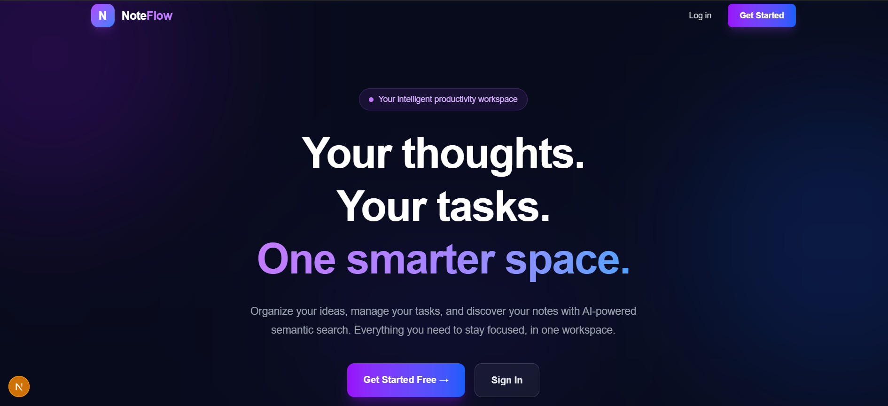
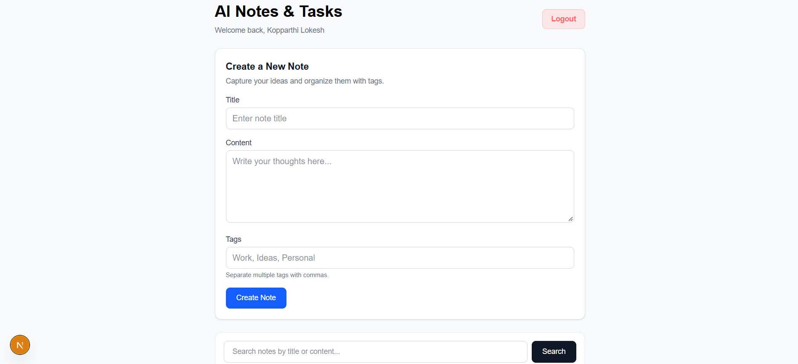
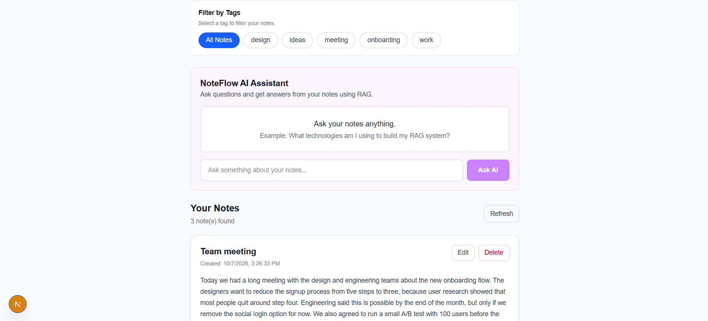

A full-stack productivity app for managing notes and note-linked tasks,
generating AI summaries, and finding related notes through semantic
search.

## Features

- **Authentication:** bcrypt password hashing, JWT authentication, and HTTP-only cookies.
- **Backend Development:** Next.js Route Handlers for application APIs.
- **Database Management:** Prisma ORM with Neon PostgreSQL.
- **AI Integration:** Groq API for LLM-powered summarization and responses.
- **Embedding Models:** Hugging Face Transformers.js with 384-dimensional vectors.
- **Vector Search:** PostgreSQL pgvector with cosine-distance similarity.
- **RAG Pipeline:** Retrieval of relevant note chunks or content followed by context injection into LLM prompts.
- **Application State:** Zustand for client-side state management.
- **Frontend:** Next.js App Router, React, TypeScript, and Tailwind CSS.

## Tech Stack

| Layer | Technologies |
|---|---|
| Frontend | Next.js App Router, React, TypeScript |
| Styling | Tailwind CSS |
| State Management | Zustand |
| Backend & API | Next.js Route Handlers |
| Database | Neon PostgreSQL |
| ORM | Prisma |
| AI Integration | Groq API |
| Embeddings | Hugging Face Transformers.js |
| Vector Database | PostgreSQL pgvector |
| Authentication | bcrypt, jose, HTTP-only Cookies |

## Screenshots

### 1. NoteFlow – Home Page


### 2. Dashboard – Notes & Task Management


### 3. AI Assistant – Semantic Search



## Quick Start

### Requirements

-   Node.js LTS and npm
-   PostgreSQL database with `pgvector`
-   Groq API key

### Install

``` bash
git clone <YOUR_GITHUB_REPOSITORY_URL>
cd <YOUR_PROJECT_DIRECTORY>
npm install
```

### Configure

Create `.env` in the project root:

``` env
DATABASE_URL="YOUR_POSTGRESQL_CONNECTION_STRING"
GROQ_API_KEY="YOUR_GROQ_API_KEY"
GROQ_MODEL="YOUR_CONFIGURED_GROQ_MODEL"
SESSION_SECRET="YOUR_SECRET_AT_LEAST_32_CHARACTERS_LONG"
```

Never commit `.env` or publish its values.

### Database and development

Ensure the PostgreSQL `vector` extension is enabled, then follow the
migration workflow configured in this repository.

``` sql
CREATE EXTENSION IF NOT EXISTS vector;
```

``` bash
npx prisma generate
npm run dev
```

Open <http://localhost:3000>.

## Project Structure

``` text
project-root/
├── prisma/
│   └── schema.prisma
├── public/
├── src/
│   ├── app/
│   │   ├── api/
│   │   │   ├── auth/
│   │   │   ├── notes/
│   │   │   ├── tasks/
│   │   │   ├── ai/
│   │   │   └── embeddings/
│   │   ├── dashboard/
│   │   ├── login/
│   │   └── signup/
│   ├── components/
│   └── lib/
├── .env.example
├── package.json
└── README.md
```

This is a high-level structure; verify directory names against the
current repository.

## How It Works

**AI summarization:** Note content is sent to the configured Groq model,
and the generated summary is streamed to the client.

**Semantic retrieval:** The embedding model converts note text and
search queries into vectors. PostgreSQL `pgvector` ranks stored note
vectors by cosine distance.

> Semantic retrieval is implemented as a search capability. This README
> does not describe it as a complete retrieval-to-LLM RAG chat workflow.

## Usage

1.  Register and log in.
2.  Create notes and add tags.
3.  Use the task functionality for tasks associated with notes.
4.  Request an AI summary.
5.  Search for notes by meaning using semantic search.

## Contributing

Fork the repository, create a feature branch, make and test your
changes, then open a pull request with a clear description. For major
changes, open an issue first.

## License

No license has been specified. Add a `LICENSE` file before granting
others permission to reuse, modify, or distribute this project.

## Author

**Lokesh Kopparthi**\
[GitHub](https://github.com/kopparthiLokesh) ·
[LinkedIn](https://www.linkedin.com/in/kopparthilokesh/)
